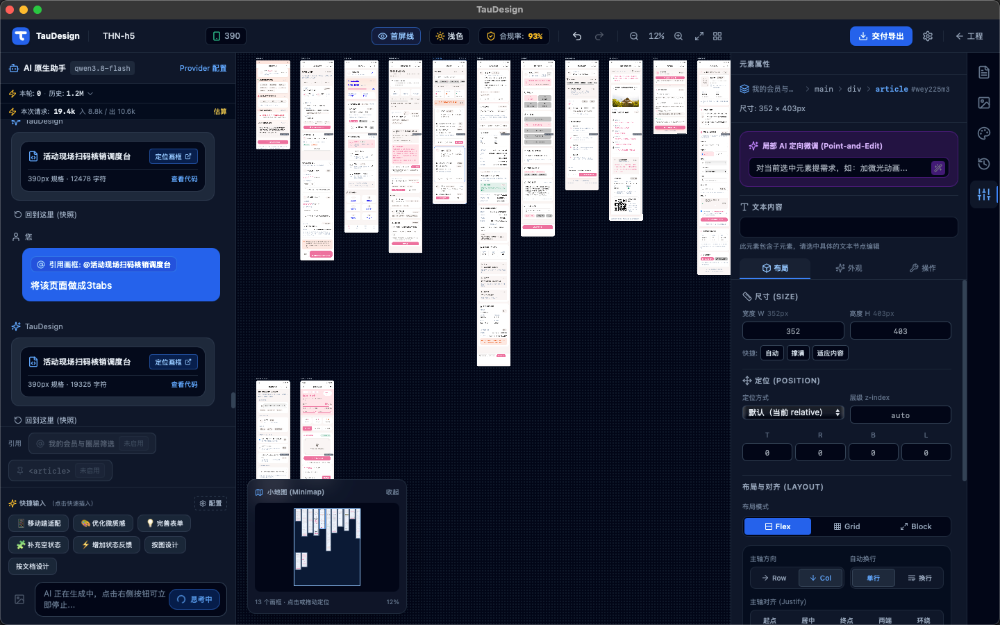

# TauDesign

[English](./README.md) | [简体中文](./README.CN.md)

<p align="center">
  
</p>

<p align="center"><strong>An AI-assisted design workspace with a local project format and an infinite canvas.</strong></p>

<p align="center">
  
  <br><sub>Workspace overview. The current interface may differ from this screenshot.</sub>
</p>

<p align="center">
  
  
  
</p>

TauDesign turns product requirements, reference images and existing HTML into editable, high-fidelity UI designs. Arrange pages on one canvas, refine elements visually, compare AI proposals and export HTML or PNG. Desktop projects live in local `.aidesign` folders.

**Developer Preview:** the current scope is static UI design and design handoff. Clickable business prototypes, real form submission and role state machines are outside the current acceptance scope. Review generated content and keep backups of important projects.

## Features

| Area | Capabilities |
| --- | --- |
| Canvas | Multiple pages, pan and zoom, minimap, automatic placement and first-screen guides. |
| Devices | Immutable Mobile/PC project profiles, reference device presets and device-aware layout constraints. |
| AI workflows | New pages, reference-image generation, explicit element edits, reviewed page optimization, multiple pages and alternative designs. |
| Project context | View and edit uploaded documents and AI summaries; reuse relevant pages, project requirements and design rules. |
| HTML import | Preserve appearance, unify with project tokens, or selectively map colors, typography, spacing, radii and shadows. |
| Design systems | Built-in presets, custom palettes and style candidates, light/dark tokens, gradient backgrounds and style extraction from existing pages. |
| Design libraries | Import project copies, bind pinned read-only versions, or explicitly open the source library for editing. |
| Visual editing | Element selection, spacing and alignment controls, safe text edits, cascading deletion and persistent undo/redo. |
| Proposal review | Compare original and candidate pages; replace, keep both or discard after delivery checks. |
| Delivery | HTML and PNG export, resource checks, render diagnostics, candidate previews and saved delivery records. |

### Start with functionality and information

New pages and supported functionality changes first capture the user goal, required information, available actions and relevant interface states. Project documents, explicitly referenced pages and supplied images provide context; unresolved essential questions stop generation. This is a static design brief, not implemented backend behavior. Precise visual edits retain their scoped editing route.

### A controlled editing workflow

1. Reference the intended page or element explicitly in chat.
2. A precise request, such as changing one button label, goes directly to a copy-based local edit. A broad request, such as optimizing a page, first produces suggestions you can select and supplement.
3. The workflow records the target, baseline, allowed changes, device, design system and relevant project context.
4. Source, structure, text, resource and iframe render checks determine whether a candidate can be adopted. Failed or incomplete results remain unapplied.
5. Compare the candidate with the original. Adoption uses History so you can undo or redo it.

Render diagnostics include compressed body text, clipping, overlap and some contrast issues. For supported cases where horizontal action groups squeeze long text, the render report offers a layout repair preview and a local candidate. These checks cover specific rules; business accuracy and visual quality still need review.

AI model and Provider settings include **Automatic design guidance (trial)**, off by default. This application preference selects relevant guidance for new tasks; ongoing tasks keep their frozen rules. Turning it off restores general guidance and keeps existing pages and provenance.

### Design evidence and recovery

Tasks retain their selected rules, target baseline and request receipts. Candidate and delivery panels explain the checks; reopened conversations show **historical design guidance** without sending another AI request or restoring execution permissions. A rule entering a request does not prove that the model followed it or that the page passed inspection.

Supported invisible-label or zero-size control failures can receive one restricted style repair and a full recheck. Automatic repair shares the generation task's remaining quota; a user-triggered candidate repair is a separate single request. Confirmed draft-label repair changes only authorized text and records that it made no model call. Failed, cancelled or inconsistent evidence does not unlock adoption.

Conversation history uses append-only monthly JSONL files. Readers isolate malformed rows, recover missing or damaged indexes from valid month files and coordinate concurrent writes to the same project. Desktop readers also isolate invalid UTF-8 rows; these safeguards do not replace project backups.

### Large pages and generation limits

Use section generation for a new long page: plan **2–6 sections** and assemble one page after checks. Explicit multi-page requests can use a reviewed page plan. Bounded continuation handles supported truncated responses; incomplete HTML is not applied. Section and continuation checkpoints currently last only for the active session.

Manual continuation shares the original task's cumulative quota and deadline. When that allowance is insufficient, split the design or explicitly start a new generation; continuing does not reset the quota.

### HTML import and mobile navigation

Open **File → Import HTML**, or use the import action in the Pages panel. Inspect the analysis and preview, then select a preservation or token-mapping mode. A new project can derive its design system from the imported page. Existing projects can preview and confirm an extracted theme; style extraction is available in both the Design System panel and the full theme editor.

Mobile projects default to a shared WeChat-style status/navigation bar. Imported or reference-image top bars are excluded from page content under this policy. The shared chrome appears on the canvas and in PNG exports, and is excluded from exported HTML. Enable **Use custom navigation** to include authored navigation in the page design.

## Getting started

1. Open TauDesign and create a project in a local folder. Choose Mobile or PC, a reference device and a design preset or custom style. The project profile stays fixed.
2. Open **Provider Configuration** in the AI chat panel. Configure an endpoint, credentials and model, then assign the required model roles. Reference-image workflows need a vision-capable model.
3. Start with a prompt, an image, an HTML import or project documents. Enable page/element references when you want to edit existing content.
4. Review diagnostics and candidates, then export the accepted design.

Supported provider protocols include OpenAI-compatible APIs, Anthropic, Gemini and native Ollama. Presets include services such as OpenAI, DeepSeek and Aliyun DashScope. For a local endpoint, configure the corresponding protocol/model and its private-network access option when required. Credentials and model availability depend on the endpoint.

### Example prompts

| Task | Example |
| --- | --- |
| New page | “Design a clean subscription page with plan comparison, benefits and a primary action.” |
| Precise edit | “On the referenced button, shorten the label to ‘Save changes’ and retain its icon and size.” |
| Broad review | “Review this mobile page for crowded content and unclear hierarchy; let me choose the improvements.” |
| Long page | “Create a product landing page in sections: overview, benefits, pricing and FAQ.” |

### Keyboard and canvas controls

| Control | Action |
| --- | --- |
| Space + drag | Pan the canvas. |
| Trackpad scroll | Pan the canvas. |
| Cmd/Ctrl + wheel | Zoom around the pointer, from 10% to 400%. |
| Cmd/Ctrl + Z | Undo. |
| Cmd/Ctrl + Shift + Z | Redo. |
| Click an element | Select it and open its properties. |
| Double-click editable text | Edit text in place. |
| Enter / Esc while editing | Confirm / cancel the text edit. |
| Delete / Backspace with a selected node | Delete the node and its descendants. |
| Double-click a frame title | Rename the frame. |

## Projects, privacy and export

A desktop project folder contains `project.json`, page files under `screens/`, assets under `assets/`, and persisted conversation/history records. Back up the whole folder to retain its related files. Project Settings shows the project path and provides an **Open directory** action.

AI requests send your prompt and the page, image or document context included by the workflow to your configured provider. API credentials are stored in local application settings and used to authenticate requests to configured endpoints. Remote fonts and images may make their own network requests. A local model can keep AI inference on your machine; offline use also depends on the assets your pages reference.

- **HTML:** inline project styles and available resolved assets, with an optional Manifest sidecar. Imported styles may require retaining internal identifiers. Check external resources when handing off a page.
- **PNG:** 1x, 2x or 3x, for the whole page or the first screen. Desktop export prefers native rendering and measures content height; a browser-compatible fallback is available. Backend limitations, including some WebKit shadow cases, are reported explicitly.
- **Portability:** exported designs can be viewed without TauDesign, subject to their resource dependencies. Static and pixel checks do not establish implemented business behavior or identical rendering on every system.

## Build from source

### Prerequisites

The frontend uses React 18, TypeScript, Vite 6, Zustand and Immer. The desktop shell uses Tauri 2 and Rust.

Install [Bun](https://bun.sh/docs/installation) (CI pins **1.3.5**), Node.js 22 for Node-based tooling, and Rust stable/Cargo through [rustup](https://rustup.rs/). Desktop builds also need the target platform's system dependencies:

| Platform | Requirements |
| --- | --- |
| macOS | Xcode Command Line Tools; system WebKit. |
| Windows | Microsoft C++ desktop build tools, Windows SDK, WebView2 Runtime and the MSVC Rust toolchain. |
| Linux | Distribution-specific Tauri dependencies, including WebKitGTK 4.1 development packages, build tools and OpenSSL. |

See the [Tauri prerequisites](https://v2.tauri.app/start/prerequisites/) for platform setup. Run the following commands from the repository root.

### Install and develop

```bash
bun install --frozen-lockfile
```

For frontend development:

```bash
bun run dev
```

Open `http://localhost:5173`. Vite uses a strict port; stop an existing server on that port first. Browser mode uses the Vite AI proxy and a fallback storage path. Validate native file storage, system dialogs and native PNG export in desktop mode.

For the complete desktop app:

```bash
bun run tauri dev
```

Tauri starts Vite automatically; do not run a second dev server on port 5173. API credentials are configured in the app and are not required to build it.

### Validate and build

```bash
bun test
bun run type-check
bun run build
cargo test --locked --manifest-path src-tauri/Cargo.toml
```

The frontend build goes to `dist/`. To build native desktop bundles on the target operating system:

```bash
bun run tauri:build
```

Tauri bundles go to `src-tauri/target/release/bundle/`. Use the packaging script below for its platform-specific defaults.

### Collect desktop packages

The repository packaging script requires Bash and `jq`; use Git Bash on Windows.

```bash
bun run package:desktop
```

Artifacts are collected into `dist-desktop/`. The local product name and app version come from `src-tauri/tauri.conf.json`.

| Build host | Default collected artifacts |
| --- | --- |
| macOS | `.app` only; DMG and ZIP are opt-in. |
| Windows | MSI and NSIS `.exe`. |
| Linux | DEB and AppImage; RPM when `rpmbuild` is installed. |

Optional macOS formats:

```bash
PACKAGE_DMG=1 PACKAGE_ZIP=1 bun run package:desktop
```

`SKIP_BUILD=1` collects existing artifacts. `PACKAGE_PLATFORM` overrides platform detection only; it does not configure cross-compilation. Signing and notarization require a separate distribution setup.

The [Desktop release workflow](./.github/workflows/release.yml) supports version tags and manual runs, native builds, source archives and checksums. Publication waits for the required jobs to pass. See [release usage](./doc/desktop-release/README.md) for assets and configuration; workflow configuration alone does not establish that a release has been published.

## Architecture and validation scope

- Desktop AI traffic goes through the Rust proxy; browser development uses the Vite proxy.
- Each frame renders in an isolated `iframe srcdoc` document.
- Generated page styles use the token-based [base stylesheet](./src/styles/base.css), separately from the editor's Tailwind styles.
- Stable DOM identifiers, manual override layers and History protect local edits.
- The current refactor has unit, browser and macOS native evidence. Windows/Linux native acceptance remains a recorded gap; configured build targets do not replace platform testing.

See [current workflow status](./doc/design-workflow-refactor/current.md) for earlier implementation and acceptance records. The ongoing [UI design workflow plan](./doc/ui-design-workflow/README.md), [task list](./doc/ui-design-workflow/task.md) and [test reports](./doc/ui-design-workflow/test.md) track the current refactor. It is not fully accepted yet: schema/invalidation coverage, remaining delivery checks, real-model comparisons, independent human review and native-platform acceptance remain subject to their documented gates. Automatic design guidance stays off by default.

The [UI design guide (Chinese)](./doc/ui-design-guidance/guide.md) explains the generation rules for hierarchy, spacing, typography, theme backgrounds and component layout, including limits for edits to existing pages.

Detailed screenshots, project snapshots and raw validation logs remain local and are excluded from Git. The committed verification scripts and Markdown reports describe how to reproduce the controlled checks.

## License

[Apache License 2.0](./LICENSE). The software is provided “AS IS”; see the license for its terms and limitations.
