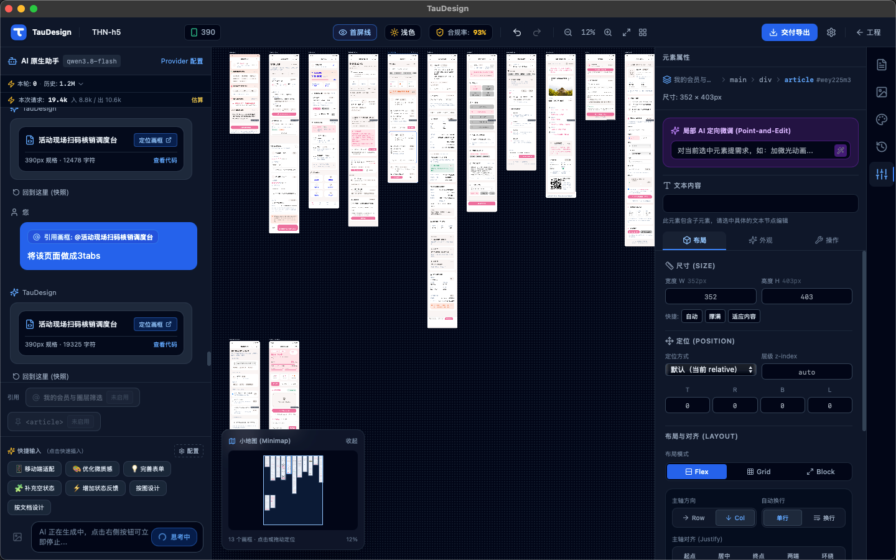

# TauDesign

[English](./README.md) | [简体中文](./README.CN.md)

<p align="center">
  
</p>

<p align="center"><strong>An AI-assisted UI design workspace with an infinite canvas and local project folders.</strong></p>

<p align="center">
  
  <br><sub>Workspace overview. The current interface may differ from this screenshot.</sub>
</p>

<p align="center">
  
  
  
</p>

TauDesign helps product managers, designers, and makers turn product ideas, reference images, and existing web pages into editable, high-fidelity UI designs. Arrange multiple screens on one infinite canvas, fine-tune details visually, compare AI design proposals side by side, and export clean HTML or high-resolution PNGs. Your desktop projects are saved directly on your computer in local `.aidesign` folders.

> **Developer Preview:** TauDesign currently focuses on static UI design and design handoff. Interactive clickable prototypes, live form submissions, and backend logic are not part of the current scope. Please review AI-generated designs and keep regular backups of important projects.

## What you can do

| Area | Capabilities |
| --- | --- |
| **Infinite canvas** | Arrange multiple pages on one board, pan and zoom smoothly, navigate with a minimap, and use automatic layout and first-screen guides. |
| **Device presets** | Choose Mobile or PC when creating a project, with reference device sizes and layout rules tailored to that screen type. |
| **AI design assistant** | Create new pages from text or reference images, edit specific elements, ask for layout improvements, plan multi-page flows, and compare alternative designs. |
| **Project context** | Upload product documents (and view or edit AI summaries) so the AI understands your goals, existing pages, and design rules. |
| **HTML import** | Bring in existing HTML pages—keep their original appearance, unify them with your project's style, or selectively match colors, fonts, spacing, corners, and shadows. |
| **Design systems** | Start from built-in presets, customize colors and light/dark themes, add gradient backgrounds, or extract a style directly from an existing page. |
| **Design libraries** | Import reusable copies into your project, pin a read-only reference version, or open the source library directly for editing. |
| **Visual editing** | Click any element to adjust spacing, alignment, and text safely; remove groups cleanly; and undo or redo changes at any time. |
| **Proposal review** | Compare the original page and AI proposal side by side; choose to replace, keep both, or discard after built-in checks. |
| **Export & handoff** | Export HTML and PNG files with built-in layout diagnostics, image checks, and saved delivery records. |

## How the AI workflow works

### Start with goals and content

When you ask for a new page or a functional update, TauDesign first clarifies the user's goal, what information needs to be shown, what actions are available, and which screen states matter. It draws context from your uploaded project documents, referenced pages, and images—and pauses to ask if essential details are missing.

### Safe, step-by-step editing

1. **Point to what you want to change:** Reference the target page or element in chat.
2. **Quick edits vs. broader improvements:** Specific requests (such as changing a button label) go straight to a safe, targeted edit. Broader requests (such as optimizing a crowded page) first give you suggestions you can review, pick from, and refine.
3. **Automatic quality checks:** Before a proposal can be applied, TauDesign checks for broken structure, missing images, squeezed body text, clipped or overlapping elements, and certain contrast issues. When a horizontal button group squeezes text on supported layouts, it can also suggest a quick layout fix.
4. **Compare and decide:** Preview the proposal next to your current page. Nothing is overwritten without your confirmation, and accepted changes can always be undone.

In **Provider Configuration**, you can also turn on **Automatic design guidance (trial)** (off by default) to let TauDesign automatically pick relevant layout and style tips for new tasks. Turning it off switches back to general guidance without affecting your existing pages.

### Keeping track of your work

Every AI task remembers which page, theme, documents, and instructions it started from, and shows what happened during generation—including any failed, stopped, or incomplete attempts—so you can always see how a design was produced.

- If you edit the original page, update your project documents, or change the theme after a proposal was generated, simply start a new request so the AI works from your latest version.
- If you replace a local image file at the same path, click **Refresh preview and recheck** to update the preview without spending another AI request.
- Conversation history is saved locally with your project. Even if a file has an unreadable line, TauDesign isolates it so the rest of your conversation stays intact (though keeping regular project backups is still recommended).

### Long pages and multi-page flows

For a long page, ask TauDesign to build it in **2–6 sections**—each section is checked before being combined into one page. You can also ask for a multi-page plan to review before generating screens. If a response gets cut off partway through, you can continue it within the same session (incomplete pages are never applied automatically).

### Importing HTML and mobile navigation

To bring in an existing web page, open **File → Import HTML** (or use the import button in the Pages panel). Preview the page and choose whether to keep its original look or adapt it to your project's theme. You can also extract a theme from an imported or existing page in the **Design System** panel or the full theme editor.

Mobile projects automatically display a shared top status and navigation bar on the canvas and in PNG exports (excluded from exported HTML). Turn on **Use custom navigation** if you want to design your own top bar inside the page.

## Getting started

1. **Create a project:** Open TauDesign and choose a local folder. Pick Mobile or PC, a reference device size, and a built-in or custom style (the Mobile/PC choice stays fixed for the project).
2. **Connect an AI provider:** Open **Provider Configuration** in the AI chat panel, enter your API endpoint, key, and model, and assign model roles. If you plan to design from reference images, pick a model that supports vision.
3. **Start designing:** Describe a page in chat, attach a reference image, import an HTML file, or upload project documents. Turn on page or element references when you want to edit something specific.
4. **Review and export:** Check any layout diagnostics, compare proposals, and export your finished design as HTML or PNG.

TauDesign works with OpenAI-compatible APIs, Anthropic, Gemini, and local Ollama, and includes presets for services like OpenAI, DeepSeek, and Aliyun DashScope. For local models running on your machine, select the matching protocol/model and enable private-network access if required.

### Example prompts

| Goal | Example prompt |
| --- | --- |
| **New page** | “Design a clean subscription page with plan comparison, benefits, and a primary action.” |
| **Precise edit** | “On the referenced button, shorten the label to ‘Save changes’ and keep its icon and size.” |
| **Broad review** | “Review this mobile page for crowded content and unclear hierarchy; let me choose the improvements.” |
| **Long page** | “Create a product landing page in sections: overview, benefits, pricing, and FAQ.” |

### Keyboard and canvas shortcuts

| Shortcut | Action |
| --- | --- |
| `Space` + drag | Pan around the canvas |
| Trackpad scroll | Pan around the canvas |
| `Cmd/Ctrl` + scroll wheel | Zoom in and out around the pointer (10% to 400%) |
| `Cmd/Ctrl + Z` | Undo |
| `Cmd/Ctrl + Shift + Z` | Redo |
| Click an element | Select it and open its properties |
| Double-click editable text | Edit text directly on the page |
| `Enter` / `Esc` while editing | Confirm or cancel the text edit |
| `Delete` / `Backspace` | Delete the selected element (and its contents) |
| Double-click a frame title | Rename the page |

## Your projects, privacy, and exports

- **Local-first storage:** A desktop project folder holds `project.json`, your pages under `screens/`, images under `assets/`, and your conversation and undo history. Back up the whole folder to keep everything together. You can view the folder path or open it anytime from **Project Settings** (**Open directory**).
- **Privacy & AI requests:** When you run an AI task, your prompt and the selected context (referenced pages, images, or documents) are sent to the AI provider you configured. Your API keys are stored locally on your machine. If you prefer offline inference, you can connect a local model (such as Ollama), keeping in mind that remote fonts or external image links in a page may still load over the network.
- **HTML export:** Packages your page with its styles and local assets (plus an optional manifest file). Remember to check any external links or fonts before handing off.
- **PNG export:** Export at 1x, 2x, or 3x resolution for either the full page or the first screen. The desktop app uses native rendering for crisp results and reports any known rendering limitations (such as certain shadow effects).

## For developers: Build from source

### Prerequisites

The frontend uses React 18, TypeScript, Vite 6, Zustand, and Immer. The desktop shell uses Tauri 2 and Rust.

Install Node.js 22, [pnpm](https://pnpm.io/) (recommended >= 12.0.0), and Rust stable/Cargo via [rustup](https://rustup.rs/). Desktop builds also require platform dependencies:

| Platform | Requirements |
| --- | --- |
| macOS | Xcode Command Line Tools; system WebKit. |
| Windows | Microsoft C++ desktop build tools, Windows SDK, WebView2 Runtime, and the MSVC Rust toolchain. |
| Linux | Distribution-specific Tauri dependencies, including WebKitGTK 4.1 development packages, build tools, and OpenSSL. |

See the [Tauri prerequisites](https://v2.tauri.app/start/prerequisites/) for platform setup, then run the commands below from the repository root.

### Install and develop

```bash
pnpm install --frozen-lockfile
```

For browser-only frontend development (`http://localhost:5173`):

```bash
pnpm dev
```

For the full desktop app (Tauri starts Vite automatically—do not run a separate dev server on port 5173):

```bash
pnpm tauri dev
```

### Test and build

```bash
pnpm test
pnpm run type-check
pnpm build
cargo test --locked --manifest-path src-tauri/Cargo.toml
```

The frontend build outputs to `dist/`. To build native desktop installers:

```bash
pnpm run tauri:build
```

Tauri bundles are written to `src-tauri/target/release/bundle/`. To collect platform packages into `dist-desktop/` (requires Bash and `jq`; use Git Bash on Windows):

```bash
pnpm run package:desktop
```

| Build host | Default collected artifacts |
| --- | --- |
| macOS | `.app` only (`PACKAGE_DMG=1 PACKAGE_ZIP=1` to include DMG/ZIP) |
| Windows | MSI and NSIS `.exe` |
| Linux | DEB and AppImage (plus RPM when `rpmbuild` is installed) |

`SKIP_BUILD=1` collects existing artifacts, and `PACKAGE_PLATFORM` overrides platform detection without configuring cross-compilation. Signing and notarization require a separate distribution setup. See [release usage](./doc/desktop-release/README.md) for details on the [Desktop release workflow](./.github/workflows/release.yml).

## License

[Apache License 2.0](./LICENSE). The software is provided “AS IS”; see the license for its terms and limitations.
