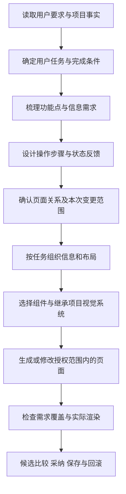

# 功能、信息与交互优先：设计流程实现审计

日期：2026-10-30。范围：当前工作区源码与既有实施文档的静态核对。本文是审计结论和增量优化建议，不表示建议已进入应用；本次不修改生成行为、默认开关或原 27 项任务的完成计数。

## 1. 结论

新建页面、调整已有页面功能，都应先明确用户任务，再确定完成任务所需信息、操作、状态反馈和页面关系，之后组织布局与视觉。

现有方案的 S2/S3、CT-01/02/05 已有这个方向，但当前实现没有完整做到“先形成可核对的业务规划，再按规划生成和验收”。普通单页主要依赖原提示词与模型推断；DesignBrief 当前更接近设计事实及通用策略摘要。多页有明确的规划阶段，但页内功能、信息、操作和状态仍以 requirements 文本承载。

建议保留现有基础，做**功能规划与需求覆盖这一层的增量重构**。单纯继续增加美学规则或仅追加一段提示词，不能解决缺功能、少信息、操作不闭环的问题；重写传输、画布、仓储与整个执行器没有必要。

## 2. 已有能力与缺口

| 环节 | 当前实现证据 | 当前能证明 | 仍然缺少 |
| --- | --- | --- | --- |
| 项目事实 | [projectKnowledge.ts](../../src/services/ai/projectKnowledge.ts)：收集项目文档与页面片段，标记来源和过期归纳；要求推断功能、字段、流程及空/错/权限状态 | 模型有相关工程资料，资料不授予执行权限 | 每项页面需求的结构化来源、冲突和任务级覆盖结果 |
| 普通单页新建 | [executor.ts](../../src/services/ai/engine/pipeline/executor.ts)：新建时构建或接收 DesignBrief，随后组装请求 | 有简表、设备/主题/组件和输入来源 | 独立的页内任务规划与完整性确认 |
| 简表内容 | [designBrief.ts](../../src/services/ai/designBrief.ts)：goal 为首行摘要；页面类型为关键词推断；actionPolicy/contentPolicy 为通用策略 | 可复现视觉事实和页面类型推断 | 用户角色、任务步骤、具体功能、必须展示的信息、操作前提/结果、业务状态与完成条件 |
| 内容义务 | DesignBrief 支持 exact/semantic 可选字段及 UI 展示；普通聊天和 Pipeline 默认构建时没有传入这些义务 | 数据结构与显示能力存在 | 从实际请求/文档提取、绑定生成与逐项验证的端到端链路 |
| 多页/多方案 | [multiPageService.ts](../../src/services/ai/multiPageService.ts)：summary、每页 requirements、links，支持编辑确认 | 页清单和静态关联可规划、检查 | 普通单页复用；页内操作/信息/状态的细分覆盖 |
| 修改分流 | [modificationEntry.ts](../../src/services/ai/modificationEntry.ts)、[useAIEngineChat.ts](../../src/services/ai/engine/react/useAIEngineChat.ts)：宽泛建议先选择，明确修改直接执行 | 尊重用户已说明的改动，不重复确认 | 在明确请求内部区分视觉小改与业务功能变更 |
| 修改分析 | [modificationReview.ts](../../src/services/ai/modificationReview.ts)：最多 8 项 title/reason/change、local/region/page 与操作 | 原页问题与修改范围可选、可保护 | 业务功能差量及其关联信息、操作、状态变化，不能将技术修改清单视为完整业务规划 |
| 执行与交付 | JSON 局部操作、区块/整页候选、History、完整性/资源/实体/渲染检查 | 很多破损、越界、丢文案和布局风险可被阻止 | 某一业务任务是否拥有必要信息、入口、结果与补救路径 |

关键代码事实：

- 新建简表见 executor.ts 的 create_screen 分支、useAIEngineChat.ts 的 taskBrief 构建；修改分支并没有同样的完整功能简表。
- `ContentObligation` 当前只在简表模块和显示中使用，默认调用没有填充；[generationQuality.ts](../../src/services/ai/generationQuality.ts) 的选项也没有接收该义务集合。不能把“字段类型已增加”报告成“功能完整性已落实”。
- [actionIntegrity.ts](../../src/services/ai/actionIntegrity.ts) 能检查原操作保留、主操作名称及部分显式删除授权，但无法证明按钮是否完成预期任务。
- [guardInterceptor.ts](../../src/services/ai/engine/pipeline/interceptors/guardInterceptor.ts) 对明确结构调整有放行分支；其他质量/资源/范围门禁仍会执行，但这不能替代“只改了本次功能、保留其它功能”的业务差量校验。
- 元素执行器以有限 class/style/text 操作为主；新增字段、子节点或重组交互可能不属于该策略的能力。应选择授权范围内可实现的策略，不能因“请求明确”就一律按样式小改处理，也不能失败后静默升级整页。

## 3. 建议的完整顺序

这表示依赖顺序，不要求用户手动完成十轮向导。工程设备、主题、保护与来源可以预先读取；视觉建议不得反过来创造业务需求。

| 阶段 | 核心问题 | 应保存的结果 |
| --- | --- | --- |
| 任务定义 | 谁、在什么场景进入、要完成什么、怎样算完成？ | 用户任务、入口背景、完成条件、事实/推断来源 |
| 功能拆解 | 必须支持哪些功能，哪些明确不在本次范围？ | 带稳定 ID 的功能列表、优先级和范围 |
| 信息需求 | 用户作决定前必须知道什么，需要输入什么，哪些信息不应展示？ | 展示信息、输入字段、必填/只读/脱敏等已知规则；未知规则不编造 |
| 交互规划 | 何时触发什么操作，需要什么前提，结果在哪里出现，如何返回或纠错？ | 操作及前提、可见反馈、目标区域/既有页面、取消/恢复方式 |
| 状态规划 | 任务涉及哪些实际状态，哪些互斥，当前画框展示哪一个？ | 条件与状态表；主场景和必要的异常/空态说明 |
| 信息架构 | 哪些信息相邻，阅读顺序是什么，主操作在哪？ | 功能/信息到页面区域的映射；需要时有低保真组织草案 |
| 视觉实现 | 用哪些已有组件和 Token 表达层级？ | 继承来源、组件/布局选择及少量适用指导 |
| 验收交付 | 需求是否有承载区域，信息是否可见，操作与反馈是否对应？ | 需求覆盖表、确定性检查、渲染证据、人工待审项和候选记录 |

功能规划不等于实现后台或可点击原型。当前静态设计范围下，仍需设计入口、选择、输入、错误、成功等交互意图及相应界面；不为此新增业务脚本，也不宣称 API、支付或权限已实现。不需要把所有互斥状态塞到同一画框；新增状态页或改变业务页数量沿用原授权和确认。

## 4. 功能修改需要有差量

新建从本页任务出发，修改从“现有功能事实 + 本次要求”出发。建议记录：

- 保留：仍需支持的现有功能、信息、操作和来源。
- 新增：本次明确增加的功能及对应信息、操作、状态。
- 调整：现有规则、字段、反馈或步骤的具体变化。
- 删除：明确授权删除的对象，不能把“优化”解释成删除。
- 影响：有关区域、页面关联、已知角色/权限与复用组件；关联不代表授权修改其它页面。

例如“把单选套餐改为可多选并显示合计”是功能修改：除了选中样式，还要考虑选择规则、合计金额与数量、未选状态、提交文案和原有权益说明的保留。不能仅替换按钮 class 就算完成。单价、优惠算法、最多选几份等未知业务条件必须保持未确认，不擅自补成事实。

纯视觉请求如“缩小角标”不重新规划业务；明确功能修改可内部形成差量直接执行；宽泛的“完善这个页面功能”先展示可选建议。只有关键业务缺口、冲突或范围扩大需要用户补充，不重复询问已明确授权的事项。

## 5. 路线选择

| 方案 | 优点 | 局限 | 判断 |
| --- | --- | --- | --- |
| 只补提示词 | 改动小、启动快 | 依旧没有结构化规划和逐项覆盖，无法定位漏项 | 可用于过渡，不能作为收口方案 |
| 扩展当前简表/合同与验证 | 复用已有链路，需求可追溯，保护和候选机制保留 | 需统一规划输出、入口接线、兼容与覆盖检查 | **推荐** |
| 重写整个生成框架 | 可以统一重新设计所有接口 | 改动大且重复已有代理、预算、History、存储和安全能力 | 当前没有必要 |

## 6. 推荐落地边界和顺序

以下为建议拆解，尚未标记实施完成；不在本轮审计中悄悄改变原先的执行行为。

### 优先一：业务简表与功能差量

扩展现有 DesignBrief 的业务部分：任务/角色、功能、信息项、操作、状态、完成条件、来源和待确认项；修改时增加保留/新增/调整/删除的差量。以版本化可选快照关联现有 TaskContract，UI 和候选读取同一快照，不另建可以独立漂移的项目 MASTER 或第二套工作流。

用户原文与展示用清理文本分别存义，不混作任务身份；多个入口使用同一规范化请求/来源绑定，避免计划写给一条请求、生成却使用另一条。现有 style contextId 不能直接当作完整业务合同身份。

验收重点：明确资料能形成可查来源的功能/信息/操作；推断单独标记；同主题的不同业务需求不能共用错误计划；纯视觉修改不引发功能变化。

### 优先二：统一新建与功能修改入口

新建单页、已有页功能修改、多页计划分别复用业务简表。输入完整且简单时本地整理或复用已确认资料；需要推理的复杂任务可做一次有界结构化规划，不默认让每次输入都多一次模型请求。规划与生成共用同一父预算，记录实际支出；额度不足停止，不在子流程重新取得额度。

策略由实际变更能力决定：视觉/text 有限操作、授权区块替换、授权整页重设计。明确指令仍可直接执行；只在缺关键业务事实或需要扩大范围时澄清。多页 links 继续由既有页面身份/来源检查承接。

验收重点：“新增字段”不误走仅改 class 的路径；明确修改不重复展示泛化选择；宽泛建议未选不执行；未授权页面与功能不变。

### 优先三：信息架构先于视觉检索

先从任务和信息确定区域、主次操作与状态承载，再提供适用排版/角标/色彩指导。风格、行业关键词、参考图和规则检索都不得决定价格、资格或业务权限。沿用原项目主题，不因功能分析额外生成主题候选。

验收重点：不同视觉主题下同一任务的必需信息与操作不丢；参考图有装饰区域时不把它误认为必需功能。

### 优先四：需求到结果的覆盖检查

建立“功能 ID → 信息/操作/状态 → 页面区域/节点 → 检查证据”的映射。自动检查明确字段、指定文案、可见操作、有效静态目标等可靠项；显示存在不等于业务语义正确，纯字符串匹配和模型自评均不足以证明功能完整。不能可靠判断的语义项列为未验证/待人工审阅。检查分级沿用原 required/advisory 合同。

验收重点：漏字段、漏反馈入口、引用错误目标有具体依据；图标或隐藏文案不能替代必需操作；检查不能通过删除原需求降低标准。保存重开/采纳复核仍使用冻结计划和既有来源检查。

### 优先五：界面与评估

现有可折叠设计简表增加任务、功能、信息、交互和待确认摘要；功能修改展示本次差量，不把内部类名或 JSON 作为用户必填项。进度按真实规划/生成/校验显示；原候选比较、取消、一次修复和 History 保留。

增加功能覆盖维度的固定夹具：普通单页、参考图、明确功能修改、纯视觉修改、多页关联、冲突/缺信息、角色差异、失败/取消及旧工程兼容。与既有 M5 模型对照结合，除了外观还记录任务完成度和漏项。真实任务覆盖未达标时不因规则命中率高就默认启用。

## 7. 与原实施进度的关系

原 12/27 表示既有任务的完成数量，不能等同于“完整设计过程已具备 44% 业务能力”。M2-03 已交付页面类型与可选内容义务结构，其当前验收不能证明功能规划和实际义务提取已完成。S3 中的完整业务简表仍需要本报告指出的端到端接线与验证。

建议将后续优先级调整为：业务简表/功能差量 → 单页和功能修改接线 → 需求覆盖检查 → 全入口规则一致性及 M5 对照。已有可靠的来源、预算、渲染、候选和持久化能力继续复用；本报告不把尚未完成的 15 项任务清零，也不扩大成可点击原型开发。

## 8. 本次验证边界

已核对方案 S0–S9、设计标准 CT、简表及默认调用、新建 Pipeline、项目知识、多页计划、修改分析/分流、元素执行能力、生成质量及新页交付检查。结论来自当前源码，未以 Prompt 的措辞作为已实现的结构化能力。

本次仅新增审计文档与索引/记录，未改变业务源码或执行真实模型请求。文档链接和差异格式单独核验；不将上一轮的 2,302 项通过结果改写为本次又跑了一遍。审计也不证明此前每条单测、原生导出或真实用户工程已满足新的业务覆盖建议。

实施更新：用户随后要求开始实施。当前结构化规划器及 Pipeline 显式试点已有代码与受控证据；普通入口、恢复和覆盖链路尚未收口。本文上方为实施前审计快照，当前状态见 [function-first-implementation.md](./function-first-implementation.md)。
