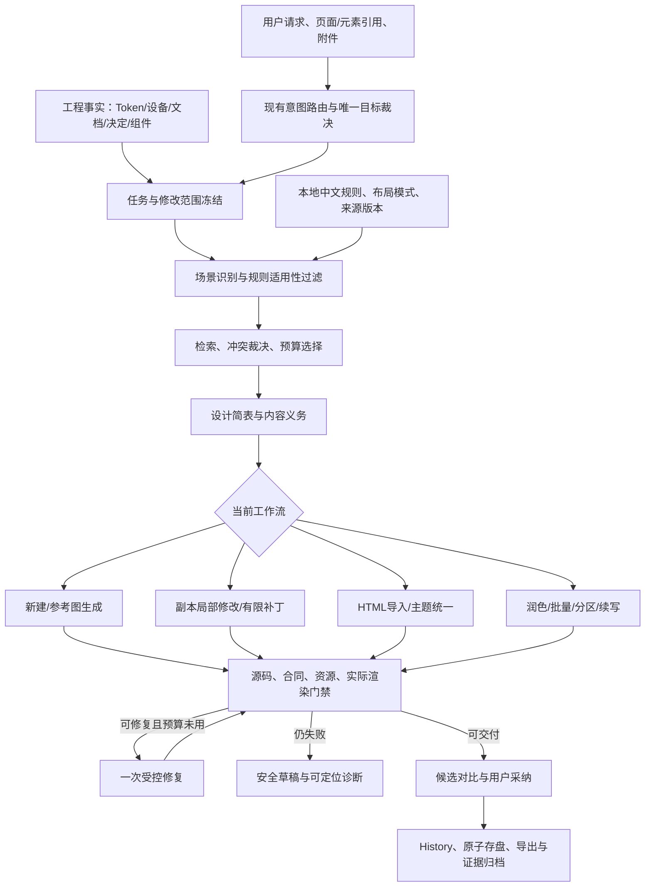

# 完整实施方案

2026-10-29，状态：**分阶段实施中**。以[流程合同](./spec.md)和[统一设计规范](./design-standards.md)为目标，按里程碑增量接入现有代码；实际完成项以 task.md/test.md 为准，不能将本文的目标描述作为已经交付的声明。

## 1. 总体架构



E 的通用推荐不能扩大 C 的授权。R 的返回边受显式计数控制，不是可无限执行的循环。所有请求继续通过现有 AIService/Rust 代理，画框继续 iframe srcdoc。

## 2. 单一知识体系与数据模型

### 2.1 分清五类对象

| 对象 | 内容 | 权威与保存 |
| --- | --- | --- |
| 工程事实 | 主题、设备、组件、项目文档、全局/页面决定 | 现有 ProjectData/Decision；不复制成另一份可编辑主题 |
| 设计规则 | 语义目标、适用条件、正反例、实现及验证方式 | 随应用发布的本地只读数据；内容可按版本审阅 |
| 布局模式 | 页面分区、内容顺序、主次操作和状态义务 | 语义布局合同；不是完整页面 HTML 母版 |
| 风格方案 | 颜色、字体、密度、材质等已支持参数 | 复用设计系统预设/自定义候选，已有工程默认继承 |
| 本次选择与回执 | 实际选择、排除、注入、预算及校验 | TaskContract/候选/交付侧车，只保存当前任务小快照 |

### 2.2 建议的最小规则模型

以下是类型草案，落地前与现有运行时校验器对齐；不是承诺引入通用规则语言或插件系统。

```ts
interface DesignRule {
  id: string;
  version: number;
  status: 'active' | 'supplemental' | 'deprecated';
  replacedBy?: string;          // 废弃重定向；检查目标存在且无环
  tier: 'core' | 'contextual'; // 底线不参与 Top-K 竞争
  title: string;
  aliases: string[];             // 中文、英文和常见混合术语
  scope: {
    operations: string[];       // 与现有 workflowCatalog 枚举对齐
    devices: Array<'pc' | 'mobile'>;
    pageKinds: string[];
    components: string[];
  };
  intent: string;               // 如“长文本自然回流”
  triggers: string[];           // 仅注册的类型化条件键，不执行表达式
  conflictsWith: string[];      // 显式互斥规则 ID；冲突不由 BM25 裁决
  guidance: string;
  examples: { positive: string; negative: string }[];
  implementation: {
    mode: 'native-token' | 'registered-source-css';
    classes: string[];
    example?: string;
  }[];
  exceptions: string[];
  validation: {
    kind: 'source' | 'render' | 'human';
    checkId?: string;           // 只引用注册校验器，不能执行数据中的代码
    severity: 'blocker' | 'warning' | 'advisory';
  };
  source: { title: string; locator: string; revision: string;
    reuse: 'original-summary' | 'adapted' | 'verbatim'; attribution?: string };
  reviewedAt: string;
}
```

触发条件优先采用少量类型化元数据：页面类型、组件身份、节点是否包含长文、是否有固定区域等。首期不实现可执行表达式或任意 selector 规则脚本。对高风险判定采用已有确定性检查器，数据中的 severity 本身不能授予阻断能力。

目录构建时检查 ID/别名冲突、废弃指向、字段完整、验证器存在、两档位类名支持以及示例资源/脚本安全。导入来源 CSS 的样例按来源合同独立校验，不强迫套原生白名单。

`scope` 中空数组明确表示“不限制该维度”；匹配先检查操作/设备/授权，再判断触发条件。`triggers` 使用注册键及已知事实，缺少事实时不视为命中；精确 ID 也不能跳过这些过滤。别名允许多个规则共享，别名碰撞记录为歧义并经范围裁决，不强制所有关键词全局唯一。`core` 从现有合同派生，不能仅靠目录作者设置 tier/severity 就新增强制要求；`supplemental` 需匹配明确触发条件，deprecated 只提供经校验的替代提示，不静默改变冻结任务。

来源字段用于追溯，不把 PDF 整页、插图或外部素材直接打包进目录。优先原创概括；实际复用代码/资料时保留适用声明，第三方字体/图片单独登记。规则数据不包含可执行脚本、自动下载地址或改变授权的命令。

### 2.3 规则选择包与实际请求回执

选择包至少包含：目录版本/内容指纹、任务/目标基线/设备/主题绑定、query 意图、匹配模式、所选 ID/版本/内容指纹、命中原因、被排除原因、冲突、回退、预算与省略项。

在最终消息拼装后生成实际请求回执：消息指纹、实际注入的规则、未注入项及原因、模型/Provider 身份。只检索但因预算删除的规则不能记录成“本轮已使用”；生成器自称使用不作为回执。

回执分为 `assembled`（已组装）、`dispatched`（已交传输层）、`completed/failed/cancelled`；只有 dispatched 可称“已发送”，不能由组装完成推断 Provider 已接收或模型遵从。每次续写、分区、重试和修复使用独立 requestId、parentTaskId、用途及规则子集回执。传输适配后的语义消息指纹由可信调用点记录，凭证和数据 URL 不进入日志；不能只散列裁剪前的计划文本。

复现所需的少量规则正文/选择快照沿用候选和交付侧车保存，不保存整库或重复主题，不存 API key、base64 图片正文或无必要的隐私工程资料。历史规则快照不能授予当前修改权。

## 3. 场景识别、中文检索和冲突处理

### 3.1 检索步骤

1. 读取现有 TaskContract 的操作、目标、元素、设备及允许修改范围；先过滤无关和过时条目。
2. 从用户指令、工程摘要与目标结构提取一个主要设计意图。局部角标修改不生成整页行业推荐。
3. 中文词典/短语别名归一化；不依赖网络翻译。补充中文二元片段或其它经过验证的轻量分词，并保留英文类名/URL等特殊 token。
4. 使用本地 BM25/明确标签匹配。精确规则 ID、明确组件和目标范围优先于宽泛词汇；评分是相关性指标，不叫“置信概率”。
5. 应用设备、来源、主题与作用域冲突过滤。已有主题不被行业推荐覆盖；参考图不被无关布局模板覆盖。
6. 首期每次优先最多 3 条场景规则及 1 个布局模式，由可用预算再裁剪。数字是初始上限，须用评估校准，不能为了凑数注入低相关结果。
7. 空结果/低匹配/冲突过多时，可用更窄意图重试一次；仍失败明确回退通用规则，不改变页面用途。

首期约 20–40 条规则，优先来自项目已复现缺陷和现有指南。外部仓库的规则先审阅和适配，不能整库灌入；不增加桌面 Python 依赖。

### 3.2 必须测试的查询

- “放大铃铛，缩小右上角数字”：组件级角标规则，禁止命中营销页重做。
- “对话建议正文被挤成一列”：正文宽度/操作组规则，不能只检索到 text-nowrap。
- “优化页面”：走现有分析选择流程，检索只支持分析，不直接修改。
- “会员档案”：不得只因“会员”判为列表，应结合详情目标与引用页面。
- “recharge 套餐选中背景”：中英混合，命中套餐/背景语义，主题值仍取当前项目。
- 与设计无关的问答、空输入和未知类别：正确不注入或回退，不能返回随机高分设计方案。

## 4. 设计简表、内容义务与 Prompt 预算

### 4.1 增强 DesignBrief

在现有设计简表上增加可选的页面类型、布局模式、必需区域、主要/次要操作、需要呈现的状态、精确/语义内容义务、主题继承、参考来源及待确认推断。

业务事实由用户/工程文档支持，规则只规定组织方式。对关键业务事实缺失而无法可靠执行的任务，使用现有澄清机制；普通风格偏好不强制停下来询问。

不必每页额外调用一次模型：优先确定性事实与本地检索；复杂任务的简表可复用已有分析/计划响应。新增模型调用必须在进度和消耗中显示，不能为每个入口隐式增加多轮请求。

### 4.2 组装方式

完整 HTML 生成继续使用现有 PromptBuilder。JSON 分析/规划、有限补丁、分区正文和续写保留各自输出协议，通过共享的规则渲染适配器使用同一选择包；不能把要求“返回完整 HTML”的系统消息塞入仅允许 JSON 的补丁入口。统一的是选择、预算和来源合同，不强求所有请求采用同一个系统提示词。常驻底线保留，场景规则替换/去重当前泛化工艺段，不以附加整库的方式扩张提示词。设备、导航、组件、源码安全和输出合同不得被预算裁掉。

优先保留：当前用户指令/授权和目标基线 → 工程与设备事实/保护 → 内容义务和输出合同 → 必需参考及组件 → 少量场景规则 → 非必要解释与示例。

现有 PC/techBlue/空上下文的 10000–12000 字符基准测试保持不变，不能提高上限掩盖增长。规则窗口根据“去除可替换工艺段后的实际长度＋安全余量”计算；预算不足先少选或回退，不截断一条规则/示例。参考文档与原页上下文的总预算另按模型能力管理，不能误把 12000 字符的基准测试当成所有请求的 token 上限。

总请求输入、思考/正文输出、分区/续写和修复分别记账。中文不能机械按四字符一个 token 估算；使用现有可用统计或保守估计，能力未知时明确显示估计，不承诺精确值。

实施时在现有预算之上共享一个父任务账本：记录最大请求数、总输出申请量/实际用量、单次与总时限、取消状态及修复次数。区块、传输重试、续写和修复都扣减同一总额，不能每层重新取得完整预算；并发请求先预留，结算时释放剩余，缺失 usage 保守记账。保留当前有效默认值并在 M0 记录；本方案不擅自扩大额度。额度不足展示未完成区块和原因，不自动换模型或新增拆页。完整输入（含历史/源 CSS/参考图成本）装不下时缩小已授权处理单元或请求必要澄清，不截去原页和保护合同强行发送。

## 5. 接入现有模块的具体位置

| 位置 | 修改职责 | 明确不做 |
| --- | --- | --- |
| `src/services/ai/craft/` | 由审阅后的结构化目录派生通用/场景指导，保留兼容导出 | 不维持两套手写规则/白名单 |
| 建议新增 `src/services/ai/designKnowledge/` | schema、目录、中文术语、选择器、预算、静态校验 | 不新建 AI 请求/存储/History 框架 |
| `workflowCatalog.ts` / `designWorkflow.ts` | 声明各入口是否使用场景规则，增加可选来源身份 | 不改变明确小改/宽泛优化优先级 |
| `designBrief.ts` | 用场景与工程事实形成简表，保留旧输入兼容 | 不将关键词命中当业务事实 |
| `promptBuilder.ts` / Pipeline / 专用请求构建器 | 共享规则渲染适配与预算，按 HTML/JSON/片段/续写协议组装，记录实际请求回执 | 不复制规则源，不把完整 HTML 协议强塞进 JSON 补丁 |
| `workflowSources.ts` / 候选证据 | 验证选择包、实际注入及当前来源绑定 | 不采信模型输出的“已经参考” |
| `modelHtmlResult.ts`、`boundedContinuation.ts`、`sectionedGeneration.ts`、`restylePatches.ts` | 传递相同规则版本/内容义务/上下文绑定，合并后复验 | 不新造第二套续写或自动拆页机制 |
| `workflowValidation.ts` / 创建、候选、重塑验证 | 复用门禁，逐项接入经过夹具验证的内容/组件检查 | 不因每条规则标为 High 就全部阻断 |
| `src/services/import/`、`importViewport.ts` | 保真/统一分流；规则用于适用诊断和可靠转换 | 不把私有来源类一律改写成原生类 |
| 现有候选/交付仓储与 Project Store | 保存小快照，扩展过期判断和 History 范围 | 不绕开仓储直接写工程或 localStorage 正文 |

以上为建议目录和职责；代码实施时先核对当前签名，新增文件以最小边界为准，不为了目录完整建立空模块。

## 6. 检查与修复设计

### 6.1 四种结果

- **阻断**：当前任务要求的确定性检查已执行并确认违反合同/严重质量底线。
- **警告**：可交付但存在具体风险或边界；用户能查看对应节点和证据。
- **未验证**：检查器不支持、未运行或依赖不足，不能当作通过。
- **设计建议**：需要人工判断的主次、材质和风格改进。

不要直接把这四种显示结果写进现有 stage 状态枚举而破坏旧候选解析；底层 stage 的通过/阻断/待验证保持兼容，新增 findings 层明确表达建议与未验证原因。

冻结任务时由受信任的工作流检查注册表确定 `required` 与 `advisory`，不能由模型或用户上传文档降低等级：

| 检查情况 | 采纳行为 |
| --- | --- |
| required 已失败 | blocked；不得替换或两版采纳 |
| required 未执行/环境不可用 | pending 或既有 blocked；只保留草稿，不解锁采纳 |
| advisory 未验证/警告/设计建议 | 可以在全部 required 通过后采纳，显式显示局限 |
| 不适用 | 记录适用性依据，不伪装成“检查通过” |

自动检查不了的语义义务默认列为待人工审阅；仅当任务已声明必需且有明确人工验收方式时，人工确认才满足该义务。人工判断不能替代源安全、资源、授权和必需渲染检查。规则要求与来源/保护范围冲突时，不通过删除原有底线解决冲突。

### 6.2 优先补的可验证项

1. 必需按钮/字段文案有对应节点且实际可见；图标替代文案、空 span 和隐藏文本不算满足。
2. 长正文/操作组/标签布局，延用已有测量，增加适用组件语义和边界反例。
3. 图标与角标预留空间的语义检查，区分正常附着、合法叠层和遮挡；不做“所有相交都错误”。
4. 参考设备与内容高度、固定条、导入 CSS/渐变和画布/导出一致性。

新增检测器先跑只报告模式及人工复核，证明误报可接受后才将可靠严重子集升级阻断。新增美学问题不能让旧工程一打开就批量失败或自动改版。

### 6.3 失败后的操作

一次自动修复仅处理本次检查结果，在副本上执行；不得通过删文案、降低检测阈值或给检查器增加例外来“修好”。保留修复前后证据与计数，相关检查重新执行。

候选采纳时绑定原页/候选内容、Token、设备、导航、来源和规则选择包。规则目录更新不能让历史候选静默采用新规则；需要使用新规则时生成新的任务快照并复验。

失效按依赖判定：仅目录新增无关规则或版本号变化，不使持有完整旧快照的任务失效；所选正文/选择/授权/输入依赖变化则重新冻结任务。必要检查器版本、字体/资产或渲染环境变化，仅使相关验收证据失效，原输入不变时可先复验，不必重新生成。模型变化禁止接续旧生成检查点，但不抹掉已完成候选的历史 Provider 来源。规则安全撤回由应用受信任策略显式阻断并说明原因，不能偷偷替换旧规则。保护/作用域与页面基线改变不能仅重新测量就解锁覆盖，必须重新确认适用的任务合同。

## 7. 界面与进度

- 对话增加可折叠“设计依据”，显示页面类型、布局模式、继承主题、规则/来源、回退或预算省略；不显示类名清单作为用户必填项。
- 明确局部修改直接显示执行与范围摘要；宽泛分析维持选择/补充文字卡片。
- 新项目/主题建议复用已有设计系统候选；页面风格提取入口在设计系统与完整编辑器指向同一功能，避免重复实现。
- 候选检查卡清晰区分阻断、警告、未验证和建议，支持定位对应区域；对比蒙版和既有采纳操作保留。
- 进度按读取上下文、检索、规划、请求、接收、续写/分区、校验、修复、待采纳显示真实阶段；本地步骤不伪装成 AI 进度。
- AI 通信简略信息只显示模型、阶段、耗时、最近活动、思考/正文计数、请求数与估计预算；不泄漏密钥，不把没有返回数据的等待伪装为百分比增长。
- 有等待时限、总时限和取消反馈；关闭/停止后不能由迟到响应再应用结果。

## 8. 六个实施里程碑

| 阶段 | 主要任务及依赖 | 产物 | 放行条件 |
| --- | --- | --- | --- |
| M0 基线与合同 | 核对现有未提交变更、入口及历史证据；冻结正反例；同步需求 | 基线指纹、场景集、需求映射 | 已有规则/明确小改/导入/采纳无基线退化 |
| M1 规则目录 | 依赖 M0；提炼 20–40 条中文规则，建立 ID/版本/来源/适用性与静态校验 | 规则数据、生成适配、目录检查 | 未审阅/过时规则不默认生效，类名/来源合同验证通过 |
| M2 选择与简表 | 依赖 M1；中文检索、过滤、回退、预算及简表内容义务 | 本地选择器、DesignBrief 增强 | 锁定关键查询正确，负例无错误注入；原预算不放宽 |
| M3 全入口与证据 | 依赖 M2；统一接线、请求回执、候选/续写/导入作用域和过期校验 | TaskContract 扩展、侧车快照、迁移测试 | 原有入口无绕过，明确小改无额外确认，旧工程兼容 |
| M4 检查与界面 | 依赖 M3；新增可靠内容/组件检查及依据显示、进度、一次修复 | 检查证据、用户可读反馈、交互回归 | 没有新的误阻断、无响应按钮或修复扩围；采纳/撤销/重开一致 |
| M5 对照与交付 | 依赖 M4；离线评估、双浏览器、真实模型固定夹具及真实工程只读副本 | 评估报告、更新指南、发布/回滚记录 | 质量收益达成、成本达标且无严重回归后才默认启用 |

阶段以实际验收推进，不按“代码写完”或固定日历自动放行。任务粒度与逐项检查见 `task.md`、`check.md`。

在 M2 完成后先以真实请求形状做预算/协议干跑；M3 首先打通“新建长正文页、明确角标局部修改、保真导入排除”三个纵向场景，再扩展全入口。可使用校准样例做早期对照，及早发现无收益/耗时增加；正式留出集仅在 M5 使用。若选择器与简单标签/别名基线相比没有收益，保留较简单实现，不为 20–40 条数据强制引入 BM25。M4 中已有且通过的检测/进度/按钮行为只补回归与必要接线，不重做一遍已有功能。

## 9. 迁移、发布与回滚

1. 首期规则随应用发布，本地离线检索，无后台自动更新或新增数据库服务。
2. 工程权威结构保留。新回执作为版本化可选扩展；同步所有运行时 schema、仓储、导出和清单校验，旧字段缺失有显式兼容路径。
3. 旧工程和候选可读、可导出，不自动补写“已用规则”或新检查已通过；旧候选采纳仍需现有验证，新要求无法验证时明确显示原因。
4. 新任务使用当前目录缓存键；旧任务持有冻结快照，不因无关目录变化失效。依 §6.3 区分任务依赖变化、检查证据变化与安全撤回；上下文变更不接着拼旧 HTML。
5. 在内部/测试配置中先启用 contextual 模式，对照 baseline；通过 M5 后再默认启用。面向用户只保留有明确用途的“自动参考设计规则”控制，不暴露调参面板。
6. 关闭 contextual 即回退既有通用 craft，不撤销用户已经采纳的页面或 Token，不删除已有来源和交付档案。
7. 如增加工程配置，修改通过 History；导出继续由现有流程完成。Git 提交、标签、Release、安装包更新与本次方案审批分别处理，不自动执行。

## 10. 评估目标与验证边界

离线至少准备 60 个有明确期望的场景，建议校准 40、留出 20；必须覆盖 PC/mobile、纯中文/混合文本、明确小改/宽泛优化、导入保真、未知意图、错配负例和规则冲突。样本数是首期工程门槛，不代表足以估计总体准确率。

建议首轮离线目标：关键固定查询的正确首选 100%；不允许跨授权/跨设备注入；一般场景 P@1 ≥ 0.85，负例正确回退率 ≥ 0.95。此为拟定目标，需要冻结评分标准后执行，不能标为已经达到；不适用规则被过滤后的空结果不能为了提高命中率强行补齐。

生成对照至少覆盖 12 个实际调用模型的固定需求，每组至少 2 次，即至少 24 对、48 个任务运行；固定模型、主题、设备、输出预算、相同输入和检查器，包含长正文、角标、表单、局部修改、长页及 PC 信息页。渐变保真导入等无模型路径另做确定性回归，不掺入生成通过率。记录原始响应和失败；不得只重试较差的一组或从结果中挑成功例。

衡量首轮通过率、内容完整、严重布局问题、盲评偏好/可采纳性、返修次数、输入/输出 token 与耗时中位数。建议相对 baseline 采用率有明确改善，首轮通过率不下降、严重问题不增加；输入 token 与耗时中位数增幅分别控制在 10% 与 15% 内作为首轮目标。若小样本无法得出稳定结论，保持可选、继续采样，不宣称显著提升或全面保证质量。

评分定义在 M0 冻结：正例标注“可接受规则集合”及禁止集合，P@1 只以有可接受规则的正例为分母；负例/无适用规则单独计算正确回退，正例弃答算错。60 例中至少 20 个负例且至少 10 个在留出集，同时报告校准/留出各自 n/N；不能以混合总分掩盖留出失败。按同一场景的改写族拆分，近义改写不得跨集泄漏。

生成实验随机交错两组调用顺序、盲化截图标签，记录同一 Provider 的配置和时间段；固定种子仅在支持时使用，模型版本不可锁定时明确限制。首轮通过率是“自动修复前通过的任务/全部启动任务”；失败、取消和超时不从分母移除。至少两名独立评阅者按内容、层级、可读性及任务完成度评分，允许平局；争议未解决不算胜。建议工程放行阈值为 `(contextual 胜 + 0.5 × 平局)/全部配对 ≥ 0.60`，并满足严重缺陷不增加、必需门禁通过率不降低；这是试点判据，不是统计显著性。人手不足只记录单人探索结果，不宣称满足盲评放行。

同时报告首次与最终结果、所有输入/输出 token（思考按 Provider 计费口径避免重复相加）、总请求数及失败成本；任务耗时包含续写/修复/校验，报告中位数和最大值。10%/15% 比较基于全部任务而非只挑成功样例；usage 缺失标估计，不生成伪精确费用。若质量收益与成本目标冲突，保持可选，呈现取舍后再调整目标，不在看完留出结果后改阈值宣称通过。

源码改造每阶段按项目要求运行全量 `bun test` → `bun run type-check` → `bun run build`。涉及入口/DOM/仓储时补对应浏览器和 macOS 原生验收。Windows/Linux 原生实机缺口仍按用户此前确认保留；成功生成 CI 配置/安装包不能替代实机 IO/导出验证。
